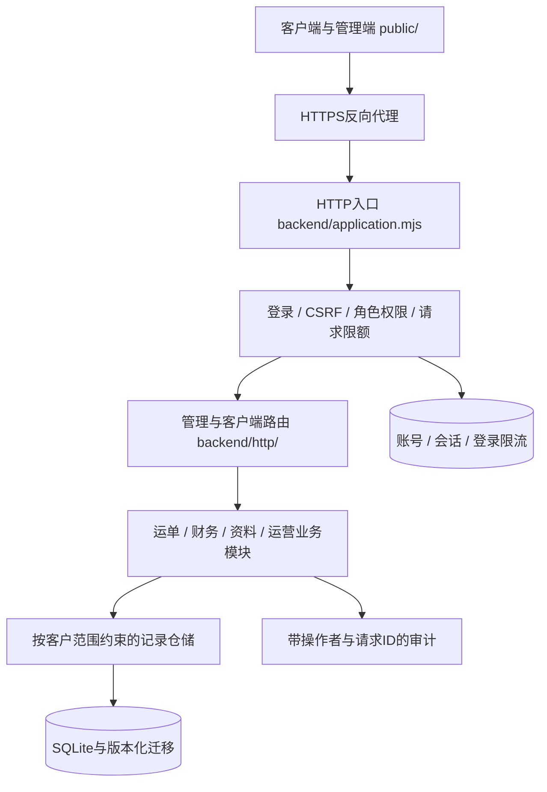

# 架构与安全改造（0.8）

本项目是带客户端和运营管理端的物流业务应用。此前0.6有Node.js后端，但没有账号、角色和客户隔离，不能用“有后端”代替安全设计。JavaScript与Java都能实现安全后端，关键在受信边界、授权和业务数据约束。

## 参考与边界

参考用户指定的[Lilishop文档](https://bdwx2tfwwt.feishu.cn/wiki/G9oywTbbrinP79kosDRcjmBinle)、[架构专题](https://bdwx2tfwwt.feishu.cn/wiki/Tq5hweh2yip1x0kUyFkczZP5nFb)、[会员登录架构](https://bdwx2tfwwt.feishu.cn/wiki/QPR0weaN3ieEuLkR4MzcFAJmnFe)。已读取的内容将API控制器、业务服务、认证、操作日志、任务、统计和防护分开；商城的商品、优惠券、拼团不是本项目需要照搬的物流模块。

参考系统采用Spring体系与JWT。本项目保留Node.js，采用模块化单体和可撤销的服务端会话，不为更换语言重写已经验证的物流规则，也不声称已使用MySQL、Redis或消息队列。

## 真实代码结构

- `server.mjs`只有进程启动职责；原有根目录业务文件是兼容导出入口。
- `backend/config.mjs`负责环境校验，生产环境缺少HTTPS站点配置时拒绝启动。
- `backend/security/`负责密码哈希、会话、CSRF、角色权限；不相信请求体中的角色或客户身份。
- `backend/http/`负责接口白名单、权限、请求解析、响应；老版接口也受管理员权限保护。
- `backend/modules/`保留运单、财务、资料与运营规则，各业务事务可嵌套回滚。
- `backend/persistence/`负责迁移、事务、客户范围查询及请求审计上下文。
- `public/`只包含浏览器资源，后端源文件、数据库、备份和环境文件没有静态访问入口。

## 权限模型

| 身份 | 允许 | 拒绝 |
| --- | --- | --- |
| 匿名 | 登录页、登录、初始化状态、健康检查、静态程序资源 | 业务数据、管理端页面、业务配置JSON |
| 客户 | 自己的运单/地址/产品/VAT/店铺/预约/舱位，已分配渠道报价，自己的账单和修改申请 | 其他客户数据、员工接口、物流状态/路由写入、直接改应收/核销、账号权限管理 |
| 运营 | 运单操作、资料、预约/舱位，提出费率及实测申请；客户资料只读 | 财务修改/核销、账号权限、系统审计 |
| 财务 | 账单、核销、客户修改审核；运单/客户/渠道只读 | 入仓操作、直接修改渠道费率、账号权限、系统审计 |
| 管理员 | 业务维护、账号/角色/启停与审计 | 自己停用/降级当前管理员、删除最后的启用管理员 |

前端隐藏控件只改善体验，真实权限均在服务器检查。权限修改和停用账号撤销所有登录会话；停用客户也使客户账号无法继续使用会话。

## 客户隔离与旧数据

客户身份来自登录账号绑定的客户ID。仓储查询、ID读取、修改、关联地址/店铺/运单和批量操作都检查同一客户范围；不能靠修改JSON字段或猜到UUID越权。

旧数据没有客户归属时，继续对有权限的员工可见，对客户默认不可见。运单、账单可在管理端分配；其他资料使用受权限保护的`record/assign`接口。旧记录不会自动全部归给第一个注册客户。已归属的账单和资料不允许直接跨客户转移。

## 财务边界

客户点击修改账单会生成待审核申请，原账单金额保持不变。财务审核通过时重新检查提交时版本，在同一事务内更新账单、保留原明细与修改原因并更新申请状态。财务同时改过账单则审批返回冲突，不能覆盖更新。

核销是追加流水，不是支付。修改后总额不得小于已核销额，已有核销不得变更币种。关联运单必须与账单客户一致。

## 仍须专项推进的内容

当前是单实例、SQLite持久化的安全基础版本，不是完整的分布式企业平台。0.8增加生产员工MFA、收款关联与不可变借贷凭证、信用放行、锁价和双人审批、关系约束、服务端分页，以及加密备份/监控定时模板。邮件/短信找回、外部身份提供商、分布式消息队列、对象存储与病毒扫描、真实承运商或支付接口尚未接入，也没有完成生产外部渗透测试及整机灾难恢复演练。

高并发或多实例上线前，仍需按目标规模测试容量及配额，评估PostgreSQL/MySQL、共享会话/限流存储和异步导入队列。当前核心客户/运单/账单关系及财务分录已使用关系表，动态业务字段继续兼容JSON文档。不能仅把监听地址改为0.0.0.0就称为生产部署完成。

## 0.8 商业服务与运维

`backend/modules/commercial/`统一处理费率审核、实测更正、放行规则、收款关联、退款和账单冲销。`ledger_transactions/ledger_lines`约束过账平衡及不可修改性；`business_* / invoice_shipments`约束核心归属；迁移会先做快照并拒绝旧数据中的不一致。动态JSON不是唯一的数据完整性防线。

`backend/operations/`实现流式加密备份、独立恢复验证、应收/分录对账和备份新鲜度检查；`deploy/`提供systemd定时模板。模板是否运行及副本是否真正异地，需要部署验证。完整政策见[业务规则](COMMERCIAL-RULES.md)，部署门槛见[0.8交付说明](RELEASE-0.8.md)。
